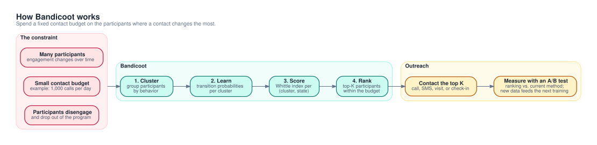

# Bandicoot

> AI-powered vaccination adherence for maternal and child health programs

**Bandicoot** is an open-source RMAB (Restless Multi-Armed Bandit) system. It helps health programs decide which caregivers to contact when outreach capacity is limited. It follows the method of SAHELI, the RMAB system that ARMMAN and Google Research deployed in India.

The reference case is childhood vaccination. The method applies to other programmes with a limited budget of human contacts, for example TB treatment adherence and digital rehabilitation. See [Other Use Cases](#other-use-cases).

**Status:** Early development. The core algorithms and a FastAPI service exist. Bandicoot has no production deployment and no measured impact yet.

---

## The Problem

Large caregiver populations, limited outreach capacity, and caregivers who drop out of the vaccination schedule.

Traditional approaches waste resources:
- ❌ Universal SMS blasts contact everyone, including caregivers who do not need help
- ❌ Random selection misses high-risk caregivers
- ❌ Manual triage does not scale to large populations

**Result:** Children miss critical vaccines, preventable diseases spread.

---

## Our Solution

Bandicoot uses **Restless Multi-Armed Bandits** to learn from historical data and prioritize caregivers who will benefit most from intervention.

### How It Works

1. **Learn Behavior Patterns**
   - Cluster 200K caregivers into ~20 behavioral groups
   - Learn engagement dynamics (who responds to SMS? who needs calls?)

2. **Compute Priority Scores**
   - Whittle index algorithm ranks caregivers by impact
   - Higher score = higher marginal benefit from intervention

3. **Optimize Daily Budget**
   - Given 1,000 contacts/day, recommend top 1,000 caregivers
   - Maximize vaccination rate under resource constraints

4. **Adapt & Improve**
   - Update based on SMS opens, clinic visits
   - System learns and improves over time

---

## Evidence Behind the Approach

Bandicoot has no impact data yet. The method comes from **SAHELI**, which ARMMAN and Google Research deployed in mMitra, ARMMAN's voice-message programme for pregnant women and new mothers:

- **Field study** ([Mate et al., AAAI 2022](https://arxiv.org/abs/2109.08075)): 23,003 beneficiaries over 7 weeks. RMAB-selected service calls reduced engagement drops by ~30% and beat both comparison groups (round-robin calls and the current standard of care). Engagement means listening to the automated health voice messages.
- **Deployment** ([Verma et al., AAAI 2023](https://ojs.aaai.org/index.php/AAAI/article/view/26849)): SAHELI reached ~100K beneficiaries.

These results measure engagement with voice messages, not vaccination. An A/B test must measure Bandicoot's effect on vaccination.

In experiment 02, the Whittle solver in this repository matched SAHELI's solver on 53 of 53 test cases (max difference 0.00009). See [experiments/INSIGHTS.md](experiments/INSIGHTS.md).

---

## Other Use Cases

The method fits any programme with these properties:

- Many participants, each with engagement that changes over time
- A fixed budget of human contacts per period (calls, visits, check-ins)
- A contact can change a participant's chance to stay engaged
- Logged engagement and contact data

| Programme | Arm | Engagement state | Action (uses the budget) |
|---|---|---|---|
| Vaccination reminders (Suvita, reference case) | Caregiver | Responds to SMS, attends clinic | Ambassador call |
| Maternal health voice messages (SAHELI) | Mother | Listens to weekly messages | Health worker call |
| TB treatment adherence (research: Mate et al., NeurIPS 2020) | Patient | Takes daily doses | Health worker follow-up |
| Digital rehabilitation (Respira Health, candidate) | Participant | Completes weekly exercise sessions | Physiotherapist or coach check-in |

### Candidate Use Case: Respira Health

[Respira Health](https://respirahealth.org) delivers an 8-week pulmonary rehabilitation programme in India through a WhatsApp chatbot, with physiotherapist oversight. In its 2026 pilot (n = 51), 31% of participants completed half or more of the 24 exercise sessions. Functional gains increased with the number of sessions completed (Spearman ρ = 0.69).

This is an RMAB problem: physiotherapist time is the limited budget, and the goal is to spend it on the lapsing participants where a check-in has the largest effect. Before an RMAB can help, the programme needs:

1. Weekly engagement data per participant
2. A randomized test of a human check-in vs. an automated reminder, to measure the effect of a contact
3. Enough participants (on the order of 1,000) to learn differences between participant groups

Bandicoot has no deployment or partnership with Respira Health. This section describes a possible application.

### Extensions Needed

The current code supports the vaccination reference case. Other programmes need these extensions:

- **N-state models** - The solver assumes 2 states (`(2, 2, 2)` arrays). Respira needs states such as (week, sessions completed).
- **Finite horizon** - The solver uses an infinite horizon (γ = 0.99). Fixed-length programmes need time-dependent indices: a contact in week 2 has more value than a contact in week 7.
- **Feature-based cold start** - Clusters come from each participant's own history. In short programmes every participant is new, so enrolment data must map participants to clusters.
- **Multiple action types** - For example SMS, call, and visit, each with a different cost.
- **Fairness constraints** - Give every lapsed participant a minimum contact, and let the RMAB allocate the remaining budget.

---

## Quick Start

### For NGOs & Health Programs

**Want to deploy Bandicoot for your program?**

See the [deployment design](docs/tech-design/04-deployment.md). A step-by-step guide does not exist yet.

**Requirements:**
- Historical SMS/call logs (6+ months)
- Vaccination records
- Cloud hosting (GCP, AWS, or Azure)
- Estimated budget: ~$200/month for 200K caregivers (design target, not measured)

### For Researchers

**Interested in the theory and algorithms?**

Read our [theory documentation](theory/):
1. [RMAB Fundamentals](theory/01-rmab-fundamentals.md) - Mathematical foundations
2. [Healthcare Problem](theory/02-healthcare-problem.md) - Vaccination adherence challenge
3. [Our Solution](theory/03-our-solution.md) - Bandicoot's architecture

### For Developers

**Want to contribute or customize?**

See [technical design](docs/tech-design/) for architecture and implementation:
- [System Overview](docs/tech-design/00-overview.md)
- [RMAB Algorithms](docs/tech-design/02-rmab-core.md)
- [API Design](docs/tech-design/03-api-design.md)
- [Deployment](docs/tech-design/04-deployment.md)

---

## Design Goals

- **SAHELI Method** - Same Whittle index approach as SAHELI
- **Scalable** - Target: 200K+ caregivers with <$200/month infrastructure
- **Cloud-Agnostic** - Docker-based, for GCP, AWS, Azure, or Kubernetes
- **Privacy-First** - No PII sharing, encrypted storage
- **Open Source** - MIT licensed, community-driven

---

## Architecture

### System Components

**Core Technologies:**
- **Python 3.10+** - Backend implementation
- **FastAPI** - REST API (OpenAPI docs auto-generated)
- **PostgreSQL** *(planned)* - Persistent storage (clusters, states, logs)
- **Redis** *(planned)* - Hot cache (Whittle indices for O(1) lookup)
- **Serverless** *(planned)* - Cloud Run (GCP), AWS Batch, or Azure Batch

**Key Algorithms:**
- **Clustering** - K-means on passive transition probabilities
- **MDP Learning** - Bayesian parameter estimation (Dirichlet prior)
- **Whittle Index** - Binary search + value iteration for priority scores
- **Cold-Start** *(planned)* - Classifier for new caregivers. New caregivers get the median index for now.

---

## Documentation

### For Stakeholders
- 📄 [Project Purpose](PROJECT_PURPOSE.md) - Why we're building this
- 📊 [MVP PRD](docs/MVP_PRD.md) - Product requirements and roadmap
- 📈 [Expected Impact](theory/02-healthcare-problem.md#expected-impact-for-suvita) - How we will measure impact

### For Engineers
- 🏗️ [Technical Design](docs/tech-design/) - Architecture (7 modular docs)
- 🔬 [Theory](theory/) - RMAB fundamentals and healthcare application
- 📐 [Diagrams](docs/diagrams/) - Visual architecture guides
- 💻 [Library](bandicoot/) - Whittle solver, MDP learning, clustering, recommender
- 🌐 [Service](app/) - FastAPI service and web UI

### For Reviewers
- 🧪 [Solver Validation](experiments/INSIGHTS.md) - Comparison with SAHELI's Whittle solver
- 🎓 [MedhAI Mentor Notes](mentor_notes.md) - AI-generated architecture review (MedhAI mentor persona)
- 📚 [Chat Archive](archive/suvita_rmab_chat.md) - Design discussion with an AI assistant (5,909 lines)

---

## Roadmap

### ✅ Phase 1: Design (Complete)
- [x] RMAB fundamentals research
- [x] Technical design (7 modular docs)
- [x] Architecture diagrams
- [x] Cost optimization (<$200/month)

### ⏳ Phase 2: MVP Implementation (6-8 weeks)
- [x] Core algorithms (clustering, Whittle solver, MDP learning, recommender)
- [x] API endpoints (FastAPI)
- [ ] Suvita integration
- [ ] Deployment + monitoring
- [ ] A/B test with 1,000 caregivers

### 🔮 Phase 3: Scale & Iterate
- [ ] Expand to 50K → 200K caregivers
- [ ] Multi-channel optimization (SMS, calls, WhatsApp)
- [ ] Fairness constraints (geographic equity)
- [ ] Generalize the solver: N states, finite horizon, feature-based cold start
- [ ] Partner with additional NGOs

---

## Contributing

We welcome contributions! Areas where you can help:

- **Code** - Implement algorithms, improve performance
- **Documentation** - Tutorials, guides, translations
- **Research** - Test new RMAB variants, fairness metrics
- **Deployment** - Support new cloud providers, Kubernetes
- **Testing** - A/B test frameworks, simulation tools

Contribution guidelines are not written yet. Open an issue to discuss a change.

---

## Credits

### Inspiration
- **ARMMAN** and **Google Research** - SAHELI, the first deployed RMAB system in public health

### Reference Use Case
- **Suvita** - The design uses Suvita's vaccination reminder programme as its reference case. Bandicoot is not deployed at Suvita.

### References
1. Verma, S. et al. (2023). "Increasing Impact of Mobile Health Programs: SAHELI for Maternal and Child Care." *AAAI*.
2. Mate, A. et al. (2022). "Field Study in Deploying Restless Multi-Armed Bandits: Assisting Non-Profits in Improving Maternal and Child Health." *AAAI*.
3. Whittle, P. (1988). "Restless Bandits: Activity Allocation in a Changing World." *Journal of Applied Probability*.

---

## License

**MIT License.** The LICENSE file is not in the repository yet.

Open-source to enable global health impact. Use freely, contribute back.

---

## Contact

- **Issues:** [GitHub Issues](https://github.com/bhi5hmaraj/bandicoot/issues)

---

**Built with ❤️ for maternal and child health**

*Bandicoot is named after the small marsupial that digs to find food - just like our system digs through data to find caregivers who need help.*
