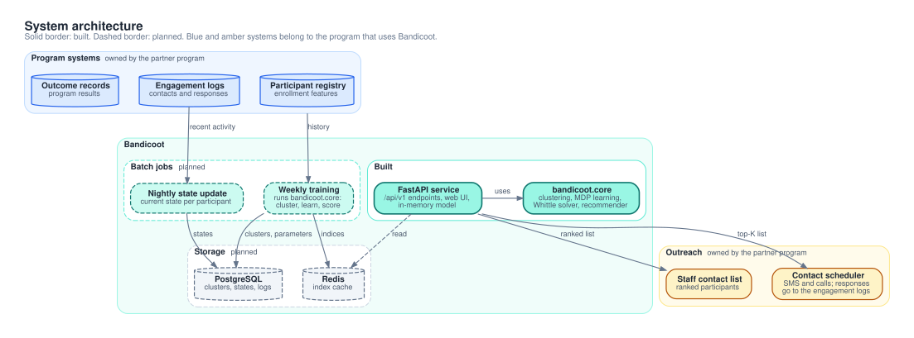
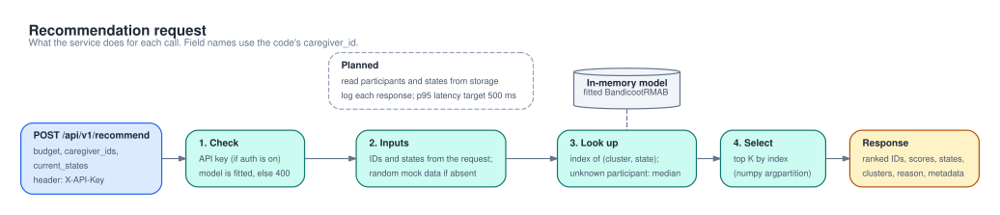
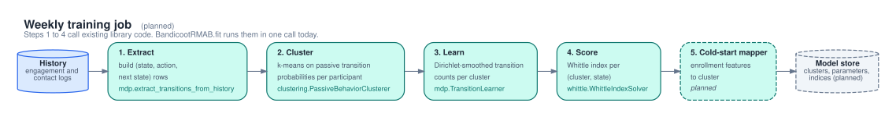

# Architecture

Bandicoot has two parts. The library (`bandicoot/`) fits the model and ranks participants. The service (`app/`) wraps the library in a FastAPI app with a small web UI. Batch jobs and storage are planned.



## Status

| Component | Status | Location |
|---|---|---|
| Whittle index solver | Built | `bandicoot/core/whittle.py` |
| Transition learner (Dirichlet-smoothed counts) | Built | `bandicoot/core/mdp.py` |
| Clustering on passive behavior | Built | `bandicoot/core/clustering.py` |
| Recommender: `fit` and `recommend` | Built | `bandicoot/core/recommender.py` |
| Synthetic transition arrays | Built | `bandicoot/data/synthetic.py` |
| `bandicoot.models`, `bandicoot.utils` | Empty packages | `bandicoot/models/`, `bandicoot/utils/` |
| Library unit tests | Built, all pass | `tests/test_whittle.py`, `test_mdp.py`, `test_clustering.py`, `test_recommender.py` |
| Solver validation scripts | Built | `experiments/` |
| JAX solver | Research prototype | `research/jax/` |
| API service, 5 endpoints under `/api/v1` | Built as a prototype: synthetic training data, mock participants | `app/main.py`, `app/api/routes.py` |
| API key check | Built, off by default | `app/dependencies.py` |
| Web UI, 3 pages | Built | `app/web/routes.py`, `app/templates/` |
| API integration tests | Built, 2 of 11 fail | `tests/test_api_integration.py` |
| Container image | Built, but the app in it does not start (see [Known limits](#known-limits)) | `Dockerfile` |
| Weekly training job | Planned | None |
| Nightly state update | Planned | None |
| PostgreSQL storage and Redis cache | Planned | None |
| Cold-start mapper from enrollment features | Planned | None |
| Log of recommendations and outcomes | Planned | None |

## Library

The library needs only NumPy, pandas, and scikit-learn (`setup.py`). It has no web or database code.

| Module | Main names | Role |
|---|---|---|
| `core/mdp.py` | `extract_transitions_from_history`, `TransitionLearner` | Turns history rows into (state, action, next state) transitions. Estimates `P[s, s', a]` with a Dirichlet prior (`alpha = 1.0`). |
| `core/clustering.py` | `extract_passive_features`, `PassiveBehaviorClusterer`, `find_optimal_clusters` | Estimates 4 passive transition probabilities per participant. Runs k-means with 20 clusters by default. |
| `core/whittle.py` | `WhittleIndexSolver`, `compute_whittle_index` | Computes `(W(R), W(U))` for one `(2, 2, 2)` array. Uses binary search and value iteration, `gamma = 0.99`. |
| `core/recommender.py` | `BandicootRMAB`, `RecommenderResult` | `fit` runs extract, cluster, learn, and score. `recommend` ranks participants. |
| `data/synthetic.py` | `TransitionGenerator`, `generate_test_scenarios` | Makes example transition arrays for 3 engagement types. It does not make history tables. |

[RMAB fundamentals](rmab-fundamentals.md) explains the model and the solver in detail.

### Data contract

`BandicootRMAB.fit(history)` takes a pandas DataFrame with one row per participant per period.

| Column | Values | Meaning |
|---|---|---|
| `caregiver_id` | Any hashable ID | Participant ID. The code uses this name. |
| `timestamp` | Any sortable value | Period of the row |
| `state` | `0` or `1` | 0 = Responsive (engaged), 1 = Unresponsive (not engaged) |
| `action` | `0` or `1` | 0 = no contact (passive), 1 = contact (active) |

- A transition is the `state` and `action` of one row, plus the `state` of the next row for the same participant.
- For other column names, pass `caregiver_id_col`, `timestamp_col`, `state_col`, and `action_col` to `fit`.
- The history must have at least `n_clusters` different participants.
- A participant with no passive transitions gets passive probabilities of 0.5.
- Transition arrays use the index order `P[state, next_state, action]`.

`recommend(states, budget, caregiver_ids=None)` takes current states (0 or 1) and IDs in the same order. Without `caregiver_ids`, the positions 0 to N-1 are the IDs. An ID that is not in the training history gets the median of all cluster indices. The result is a `RecommenderResult`:

| Field | Content |
|---|---|
| `recommended_ids` | Top `min(budget, N)` IDs, highest index first |
| `priorities` | Index of each recommended ID |
| `all_priorities` | Index of each input participant, in input order |
| `budget_used` | `min(budget, N)` |

### Usage

```python
import numpy as np
import pandas as pd
from bandicoot.core.recommender import BandicootRMAB

rng = np.random.default_rng(0)
history = pd.DataFrame({
    "caregiver_id": np.repeat(np.arange(50), 10),  # 50 participants
    "timestamp": np.tile(np.arange(10), 50),       # 10 periods each
    "state": rng.integers(0, 2, 500),
    "action": rng.integers(0, 2, 500),
})

model = BandicootRMAB(n_clusters=5).fit(history, verbose=False)
print(model.get_cluster_summary())  # size, W(R), W(U), passive retention and recovery

result = model.recommend(
    states=np.array([0, 1, 1, 0]),
    budget=2,
    caregiver_ids=np.array([3, 7, 12, 99]),  # 99 is not in the history: median index
)
print(result.recommended_ids, result.priorities)
```

Import from `bandicoot.core.recommender`. The package `bandicoot` exports only `__version__`.

## Service



`app/main.py` mounts the API router at `/api/v1`, static files at `/static`, and the web pages at `/`. FastAPI serves the OpenAPI docs at `/docs` and `/redoc`. The values in this section come from `app/api/routes.py`, `app/models.py`, and `app/config.py`.

| Method | Path | Purpose | Notes |
|---|---|---|---|
| GET | `/api/v1/health` | Service status | Public. Returns `status`, `version`, `model_loaded`, and `timestamp`. |
| POST | `/api/v1/train_clusters` | Fit a new model | Body: `n_clusters` (2 to 100, default 20) and `min_observations` (default 10). Trains on synthetic history: 100 participants, 30 periods, random states and actions. The `silhouette_score` in the response is the constant 0.65. |
| POST | `/api/v1/recommend` | Ranked top-K list | Body: `budget` (1 or more), `caregiver_ids` (strings), `current_states` (0 or 1). If IDs or states are missing, the service makes 1,000 mock participants with random states. `filter_district` is accepted and ignored. 400 if no model is fitted. |
| POST | `/api/v1/precompute_indices` | Report index counts | Computes nothing, because `fit` already computes the indices. Returns the cluster count and 2 indices per cluster. 400 if no model is fitted. |
| POST | `/api/v1/update_state` | Accept state updates | Body: `updates`, a list of `{"caregiver_id": ..., "state": 0 or 1}`. Checks and logs each update. Stores nothing. |

Each recommendation has `caregiver_id`, `priority_score` (the index), `current_state`, `cluster_id` (-1 for an unknown ID), and a fixed `reason` text per state. The `metadata` has `total_evaluated`, `budget` (the budget used), `generated_at`, and `model_version`.

**Authentication.** Set `REQUIRE_AUTH=true` and `API_KEY`. Then all endpoints except `/health` need the `X-API-Key` header. A missing key gives 401. A wrong key gives 403. `REQUIRE_AUTH=true` without `API_KEY` gives 500. The web pages and `/docs` have no authentication.

**Errors.** Invalid request bodies give 422. Library errors in `/recommend` and `/train_clusters` give 500 with the message in `detail`. An example is `caregiver_ids` and `current_states` with different lengths.

### In-memory model

`app/dependencies.py` keeps one `BandicootRMAB` object in a module variable. The first request creates it, unfitted, from the settings. `/train_clusters` resets it, fits a new object, and stores that object. There is no database and no model file. A restart loses the model. Each worker process has its own model. The Dockerfile starts 1 worker.

### Configuration

`app/config.py` reads environment variables and a `.env` file in the working directory. Names are case-sensitive. To start, copy `.env.example` to `.env`. Restart the service after a change.

| Variable | Default | Effect |
|---|---|---|
| `REQUIRE_AUTH` | `false` | Turns on the `X-API-Key` check. |
| `API_KEY` | unset | Expected value of `X-API-Key`. |
| `N_CLUSTERS` | `20` | Clusters of the first, unfitted model. `/train_clusters` uses its request value, which defaults to 20. |
| `GAMMA` | `0.99` | Discount factor. |
| `ALPHA` | `1.0` | Dirichlet prior of the per-cluster transitions. |
| `MIN_OBSERVATIONS` | `10` | Passed to the model. Only `TransitionLearner.get_confidence` uses it, and `fit` does not call it. |
| `RANDOM_STATE` | `42` | k-means seed. |
| `MAX_CAREGIVERS` | `200000` | Limit of the mock data size. The service uses the smaller of 1,000 and this value. |
| `LOG_LEVEL` | `INFO` | With `DEBUG`, the global error handler adds the exception text to its 500 response. The log level stays at INFO (`app/main.py`). |
| `API_TITLE`, `API_VERSION`, `API_DESCRIPTION` | See `app/config.py` | OpenAPI metadata. `API_VERSION` is also the `model_version` in responses. |
| `DATA_DIR`, `MODEL_PATH`, `DATABASE_URL`, `REDIS_URL`, `RECOMMENDATION_TIMEOUT` | See `app/config.py` | Read, but no code uses them. |
| `PORT` | `8080` | Docker only. The `uvicorn` port in the container. |

## Web UI

The pages use Jinja2 templates, with Vue 3 and Pico CSS from the unpkg CDN. The browser needs internet access. The pages call the API without an `X-API-Key` header, so their buttons fail when `REQUIRE_AUTH=true`.

| Page | Shows |
|---|---|
| `/` | Model status, a budget form that calls `/recommend` with mock data, the ranked list, and a CSV export. |
| `/model` | Training status, Train Model and Precompute Indices buttons, and a sortable cluster table (size, W(R), W(U), retention, recovery). |
| `/settings` | A read-only table of the model and system settings, and help to edit `.env`. |

## Planned design

Nothing in this section is built, except the Dockerfile.



- **Weekly training job.** Read the history from storage. Run the `fit` steps. Save the clusters, parameters, and indices with a model version. Make the new version active after all writes finish, so `/recommend` never reads a half-written model. Run the job outside the API process. `/train_clusters` then starts the job and returns a job ID.
- **Nightly state update.** Compute the current state of each participant from recent engagement logs. Write all states in one bulk update. Example rule: Responsive if the participant engaged in the last 7 days, else Unresponsive.
- **Storage.** PostgreSQL keeps the clusters and parameters per model version, the current state of each participant, and the indices. It also keeps a log of each recommendation, the contact made, and the outcome, for evaluation. Redis caches the index of each (model version, cluster, state) for `/recommend`.
- **Cold-start mapper.** A classifier maps enrollment features to a cluster. A new participant then gets a cluster index instead of the median.
- **Recommendation from storage.** `/recommend` reads participants and states from storage and logs each response.

**Deployment.** The existing Dockerfile builds a two-stage `python:3.11-slim` image. The image runs `uvicorn app.main:app` on `$PORT` (default 8080) as a non-root user. The planned target is a container service such as Google Cloud Run. A scheduler starts the batch jobs.

## Key decisions

| Decision | Rationale |
|---|---|
| Library first: `bandicoot/` has no web or database code, and `app/` wraps it | Test and tune the method on local data before deployment. Use the same code in jobs and scripts. |
| Precompute one index per (cluster, state) | Indices change only when the model retrains. So a request is a lookup and a sort. |
| One MDP per cluster, not per participant | One participant has too few transitions for good estimates. |
| Two states | Fewer parameters to learn. Add states when the data supports them. |
| Nightly batch state updates, not streaming | Less to build and operate. |
| Output is a ranked list | Program staff or the program's scheduler make the contacts. Bandicoot does not contact participants. |

## Known limits

| Limit | Detail |
|---|---|
| 2 states, 2 actions | `whittle.py` and `mdp.py` accept only `(2, 2, 2)` arrays. |
| Infinite horizon | `gamma = 0.99`. The index ignores the time left in a program. |
| Index clipping | The solver searches in [-2, 2]. It clips values outside this interval without a warning. See [RMAB fundamentals](rmab-fundamentals.md). |
| Cold start | An unknown ID gets the median index. `predict_cluster_for_transitions` needs passive history. |
| Synthetic training data | `/train_clusters` cannot read real history. The synthetic states and actions are random, so the clusters have no meaning. |
| ID type mismatch | The API takes string IDs. The synthetic training IDs are integers. So each API recommendation gets the median index and `cluster_id` -1, and the order of ties has no meaning. |
| No persistence | The model lives in process memory. `/update_state` stores nothing. `/recommend` does not read stored states. |
| Training blocks the server | `/train_clusters` runs `fit` in an `async` handler, so other requests wait. The handler resets the model first. A failed training leaves no fitted model. |
| Missing dependencies | `requirements.txt` does not list `jinja2`, so `import app.main` fails. The Docker `HEALTHCHECK` imports `requests`, which is not installed. |
| Web pages and Starlette 1.x | The pages call `TemplateResponse(name, context)`. They return 500 with FastAPI 0.143.0 (Starlette 1.8.0). They render with FastAPI 0.115.6 (Starlette 0.41.3). |
| `/model` page | The route reads `recommender.caregiver_ids`, which does not exist. The page shows the cluster table but not the training details. |

[Open questions](open-questions.md) lists the open engineering decisions.
