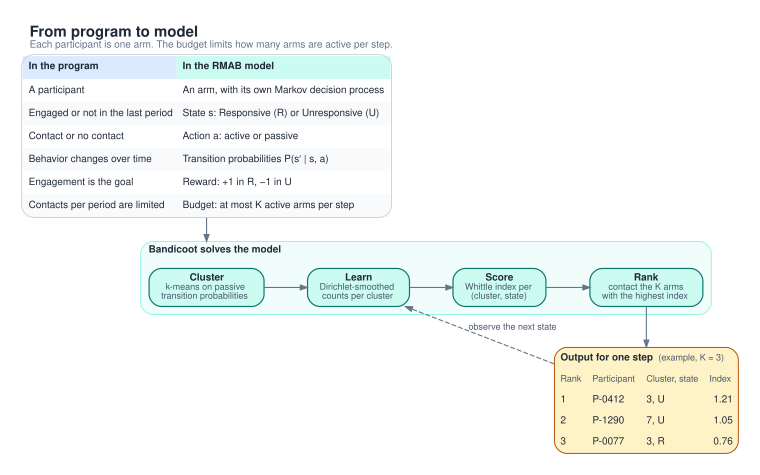
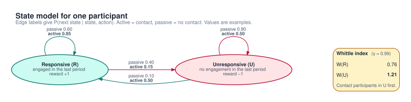

# RMAB fundamentals

This page explains the model behind Bandicoot. It also states what the code in `bandicoot/core/` computes, and where it departs from the textbook method.

## The problem

An outreach program has $N$ participants. In each period, staff can make at most $K$ contacts (a call, an SMS, a visit, or a check-in). $K$ is the contact budget. The program must choose which participants to contact.

Participant behavior changes whether or not the program makes contact. A participant who engages this week can stop next week, even with no contact. This is what "restless" means. In a classic multi-armed bandit, an arm does not change while you leave it alone.

## One MDP per arm

Each participant is one arm. Each arm is a Markov decision process (MDP).

| Element | Model | Bandicoot code |
|---|---|---|
| State | $s \in \lbrace R, U \rbrace$: Responsive or Unresponsive in the last period | `0` = R, `1` = U |
| Action | $a \in \lbrace 0, 1 \rbrace$: passive (no contact) or active (contact) | `0` = passive, `1` = active |
| Transitions | $P(s' \mid s, a)$ | array `P[s, s_next, a]`, shape `(2, 2, 2)` |
| Reward | $r(R) = +1$, $r(U) = -1$. The action does not change the reward. | `WhittleIndexSolver._get_reward` |
| Discount | $\gamma$ | `gamma = 0.99` (default) |

Write $p_{s,a} = P(s' = R \mid s, a)$. An arm then has four free numbers: $p_{R,0}$, $p_{R,1}$, $p_{U,0}$, $p_{U,1}$.

The probabilities in the diagram are examples.

## The budget constraint

The program wants to keep as many participants in R as possible:

$$\max_{\pi}\ \mathbb{E}\Big[\sum_{t \ge 0} \gamma^t \sum_{i=1}^{N} r(s_i^t)\Big] \quad \text{subject to} \quad \sum_{i=1}^{N} a_i^t \le K \ \text{ for every step } t.$$

The constraint couples the arms. The joint state has $2^N$ values. Computing an optimal policy for a general restless bandit is PSPACE-hard (Papadimitriou and Tsitsiklis, 1999). Bandicoot therefore uses an index heuristic.

## The Whittle index

**Subsidy.** Pay the arm a subsidy $\lambda$ in every period where it is passive. Solve the one-arm MDP:

$$Q_\lambda(s, 0) = r(s) + \lambda + \gamma \sum_{s'} P(s' \mid s, 0)\, V_\lambda(s'), \qquad Q_\lambda(s, 1) = r(s) + \gamma \sum_{s'} P(s' \mid s, 1)\, V_\lambda(s'),$$

with $V_\lambda(s) = \max_a Q_\lambda(s, a)$. The subsidy $\lambda$ is one number for the whole arm.

**Index.** The Whittle index of state $s$ is the smallest subsidy that makes passive optimal in $s$:

$$W(s) = \inf\lbrace \lambda : Q_\lambda(s, 0) \ge Q_\lambda(s, 1) \rbrace.$$

A high $W(s)$ means contact in state $s$ is worth a lot. The index policy contacts the $K$ arms with the highest $W(s_i)$ at each step.

**Indexability.** An arm is indexable if the set of states where passive is optimal grows as $\lambda$ increases. Without indexability, $W$ is not well defined. Bandicoot does not check indexability.

**Why it is a heuristic.**

- Whittle (1988) relaxed the budget so that it holds on average over time, not at every step. The subsidy is the Lagrange multiplier of that relaxed constraint.
- The index policy enforces the budget at every step. So it is not optimal in general.
- Weber and Weiss (1990) show asymptotic optimality for the time-average reward. This holds as $N$ grows with $K/N$ fixed, if the arms are indexable and a fluid approximation of the index policy has a globally stable equilibrium. They also give an example where the index policy is not asymptotically optimal.
- The Weber and Weiss result does not cover a small $N$, a discounted reward, or a finite horizon.

## How Bandicoot computes the index

`WhittleIndexSolver.compute_indices(P)` in `bandicoot/core/whittle.py` returns `(W(R), W(U))`.

| Item | Value in the code |
|---|---|
| Reward | $+1$ in R, $-1$ in U; the passive action adds the subsidy of the current state |
| Discount | `gamma = 0.99` by default; must be in $(0, 1)$ |
| Search interval | $[-2, 2]$ for each state |
| Outer stop | $\max_s \lvert Q(s,1) - Q(s,0) \rvert \le 10^{-5}$ (`q_convergence_threshold`), or 1000 iterations (`max_iterations`) |
| Inner stop | value iteration stops when the largest change in $V$ is at most $10^{-4}$ (`v_convergence_threshold`) |
| Input checks | shape `(2, 2, 2)`, no NaN or Inf, values in $[0, 1]$, each `P[s, :, a]` sums to 1 (tolerance $10^{-6}$) |

The algorithm:

1. Set the subsidy of each state to the midpoint of its interval. Each state has its own subsidy $\lambda_s$.
2. Run value iteration from $V = 0$. The passive reward in state $s$ is $r(s) + \lambda_s$. Both states update from the previous $V$.
3. Compute $Q(s, a)$ for both states. Find the state with the largest $\lvert Q(s,1) - Q(s,0) \rvert$.
4. Update the interval of that state only. If active is better, raise the lower bound to $\lambda_s$. Otherwise, lower the upper bound to $\lambda_s$.
5. Repeat until a stop rule applies. Return the interval midpoints.

### What the code converges to

The code uses one subsidy per state in a single value iteration. SAHELI's `planinf` does the same (see [saheli-analysis.md](saheli-analysis.md)). At convergence, both states are indifferent at the same time. So $V$ is the value of "contact every step" with no subsidy:

$$V^{\text{act}} = (I - \gamma P_1)^{-1} r, \qquad \lambda_s = \gamma \sum_{s'} \big(P(s' \mid s, 1) - P(s' \mid s, 0)\big)\, V^{\text{act}}(s').$$

With two states, this gives a closed form:

$$W_{\text{code}}(s) = \gamma\,(p_{s,1} - p_{s,0})\,D, \qquad D = V^{\text{act}}(R) - V^{\text{act}}(U) = \frac{2}{1 - \gamma\,(p_{R,1} - p_{U,1})}.$$

Check with the diagram example ($p_{R,0} = 0.60$, $p_{R,1} = 0.85$, $p_{U,0} = 0.10$, $p_{U,1} = 0.50$, $\gamma = 0.99$): $D = 3.06$, $W(R) = 0.76$, $W(U) = 1.21$. These match the solver output in the diagram. The formula also reproduces the experiment 01 values to four decimals (see [INSIGHTS.md](../experiments/INSIGHTS.md)).

Consequences:

- $D > 0$ for every arm. So within one arm, U ranks above R if and only if contact lifts $p$ more in U than in R. $W(U) > W(R)$ is not guaranteed.
- If contact does not change $p_{s,\cdot}$, then $W(s) = 0$. If contact lowers it, $W(s) < 0$.
- For an indexable arm, $W_{\text{code}}$ equals the Whittle index of the state with the lower index. For the other state, the values differ in general. The textbook value uses a $V$ in which the lower-index state is passive and collects the subsidy. The code uses $V^{\text{act}}$.
- For the three synthetic arms of experiment 01, all six (arm, state) values have the same order under both definitions. For other arms, the top-$K$ set can differ.
- $W_{\text{code}}$ can lie outside $[-2, 2]$ when $1 - \gamma(p_{R,1} - p_{U,1})$ is small. Then the search reaches the bound, runs 1000 iterations, and returns without a warning. The other state can stay unconverged. Example: $p_{R,0} = 0.3$, $p_{R,1} = 0.99$, $p_{U,0} = 0$, $p_{U,1} = 0.01$. The solver returns $(2.0, 0.0)$. The closed form gives $(45.8, 0.66)$.

## From data to priorities

| Module | What it does |
|---|---|
| `mdp.py`, `extract_transitions_from_history` | Sorts rows by `caregiver_id` (the participant ID column) and `timestamp`. Pairs each row with the state of the next row. The action of the earlier row is the action of the transition. |
| `mdp.py`, `TransitionLearner` | Counts transitions `counts[s, s_next, a]`. Estimates $P(s' \mid s, a) = (n_{s s' a} + \alpha) / (n_{s \cdot a} + 2\alpha)$, with $\alpha = 1$ by default. Uses 0.5 when a pair $(s, a)$ has no data. |
| `clustering.py`, `extract_passive_features` | Estimates passive transitions per participant with $\alpha = 1$ (fixed in code). Flattens them to four features. Two features are free, because each row sums to 1. |
| `clustering.py`, `PassiveBehaviorClusterer` | Runs k-means (`n_clusters = 20`, `n_init = 10`, `random_state = 42`) and reports the silhouette score. Needs at least `n_clusters` participants. |
| `clustering.py`, `find_optimal_clusters` | Tries $k$ from 15 to 25 and keeps the best silhouette score. `BandicootRMAB` does not call it. |
| `recommender.py`, `BandicootRMAB.fit` | Clusters participants, pools all transitions (both actions) per cluster, estimates one MDP per cluster, and computes `(W(R), W(U))` per cluster. |
| `recommender.py`, `BandicootRMAB.recommend` | Gives each participant the index of its (cluster, state). Gives an unknown ID the median of all cluster indices. Returns the top $\min(K, N)$ participants, even if some indices are negative. |

## Why clustering

- **Few observations per participant.** The budget is small compared with $N$. So one participant has few active transitions. Four probabilities per participant are hard to estimate from a few periods. The prior pulls sparse estimates toward 0.5.
- **Shared learning.** Participants with similar passive behavior form a cluster. One MDP per cluster uses the transitions of all its members, including their active transitions.
- **Fewer index computations.** The solver runs once per cluster, not once per participant.
- **Assumption.** Participants with similar passive behavior respond in a similar way to contact. The clustering does not use active transitions, so the code does not test this assumption.

SAHELI uses 20 clusters (`pipeline.py`, `CONFIG["clusters"]`). Bandicoot uses 20 by default.

## Limits

| Limit | Effect |
|---|---|
| Two states | The solver and learner reject any other shape. Engagement must be binary. |
| State-only reward | The objective is time spent in R. It is not a health outcome. |
| Infinite horizon | With $\gamma = 0.99$, the index weights about $1/(1-\gamma) = 100$ future steps (rule of thumb). Programs have a fixed length, for example a 7-week study or a vaccination schedule. The index ignores the time left. |
| Stationary and Markov | Probabilities do not change over time and depend only on the current state. Danassis et al. (2023) report deviations from the Markov assumption in maternal health program data. |
| Repeated contact | The model allows contact every step with the same effect. SAHELI's default index model assumes at most one service call per beneficiary. Bandicoot has no such rule. |
| Cold start | A participant ID that was not in the training data gets the median index. There is no model that maps participant features to a cluster. `predict_cluster_for_transitions` needs passive history. |
| Index computation | Per-state subsidies (see above). Values outside $[-2, 2]$ are clipped without a warning. Indexability is not checked. |
| Offline learning | `fit` runs on past data. The code does not explore or update online. |

## References

- Whittle, P. (1988). "Restless Bandits: Activity Allocation in a Changing World." *Journal of Applied Probability*.
- Weber, R. R., and Weiss, G. (1990). "On an Index Policy for Restless Bandits." *Journal of Applied Probability*.
- Papadimitriou, C. H., and Tsitsiklis, J. N. (1999). "The Complexity of Optimal Queuing Network Control." *Mathematics of Operations Research*.
- Danassis, P., et al. (2023). "Limited Resource Allocation in a Non-Markovian World: The Case of Maternal and Child Healthcare." *IJCAI*.

See [related-work.md](related-work.md) for more papers. See [open-questions.md](open-questions.md) for unresolved design choices.
