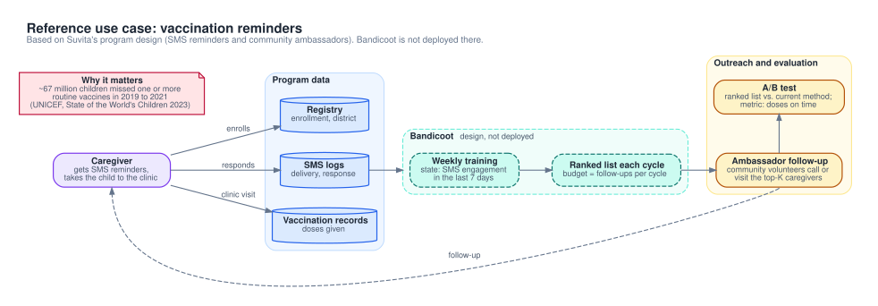

# Use case: childhood vaccination reminders

This is the reference use case for Bandicoot. It maps a vaccination reminder program to the RMAB model in the library.

**Status:** Not deployed. Bandicoot does not run at Suvita. The repo documents no data access and no partnership agreement. All tests and experiments in the repo use synthetic data.

## The program

Suvita is a nonprofit that runs a childhood vaccination program in India. It uses two types of contact:

- Automated SMS reminders before each vaccine due date (1 day and 7 days before).
- Volunteer community "immunization ambassadors" who follow up with caregivers.

These facts come from Suvita's public materials; they are not verified here. The repo cites no source for Suvita's scale or measured effects, so this page does not repeat those numbers.

## The problem

Children miss vaccine doses, or start the schedule and do not finish it. About 67 million children missed some or all of their routine immunization between 2019 and 2021 (UNICEF, *The State of the World's Children 2023*).

Every caregiver gets the SMS reminders. Ambassador time is limited, so not every caregiver can get a follow-up. In each cycle the program must choose who gets one. Bandicoot ranks caregivers by Whittle index and returns the top K. See [RMAB fundamentals](../rmab-fundamentals.md) for the model.

## Mapping to the RMAB

The library fixes 2 states, 2 actions, and the reward. The vaccination meaning of each element comes from the earlier design docs (now in git history). "Code" means the library does it. "Design" means a design doc proposed it and nothing implements it.

| RMAB element | Vaccination meaning | Status |
|---|---|---|
| Arm | One enrolled caregiver. | Design |
| State 0: Responsive | The caregiver opened or clicked an SMS in the last 7 days. | Design (2 states in code) |
| State 1: Unresponsive | No SMS engagement for 7 days or more. | Design (2 states in code) |
| Action 0: Passive | Standard SMS schedule only. | Design (2 actions in code) |
| Action 1: Active | One extra contact this cycle, such as an ambassador call or visit. | Design (2 actions in code) |
| Budget K | Number of active contacts per cycle. Ambassador capacity sets it. Example: K = 100. | Code (`budget` argument) |
| Cycle | The design docs show a weekly list and also a daily pull. | Open |
| State update | Each night, from the SMS logs. | Design |
| Reward | +1 for each step in Responsive, -1 for each step in Unresponsive. | Code (`bandicoot/core/whittle.py`) |
| Discount | gamma = 0.99. | Code default |
| Clusters | k-means on passive transition probabilities. Default k = 20. | Code default |
| New caregiver | An unknown ID gets the median Whittle index. | Code |
| Cold start | A features-only mapper assigns a cluster from registration data. A 6-week warmup comes before the first ranking. | Design |

### Why the reward uses engagement, not vaccination

- Vaccination events are sparse. Each child has a few due dates, weeks apart. Engagement gives a signal in every cycle.
- Vaccination records arrive late. The delay is not known.
- SAHELI used the same kind of signal. Its outcome was engagement with voice messages, not vaccination (Mate et al., AAAI 2022). See [SAHELI analysis](../saheli-analysis.md).
- The proxy is an assumption. Engagement may not lead to clinic attendance. The A/B test below measures vaccination itself.
- The design docs add a reward bonus when a dose is given. The code does not have this bonus.

### How this differs from SAHELI

| Aspect | SAHELI (ARMMAN mMitra) | This use case |
|---|---|---|
| Standard contact | Automated voice messages | SMS reminders |
| Active action | Live service call from a health worker | Ambassador follow-up |
| Engagement signal | Listening to voice messages | SMS open or click, if tracked |
| Outcome measured | Engagement drops | Vaccination (not measured yet) |
| Outcome data | Call logs | Vaccination records, with a delay |

## Data needed

The field names come from example schemas in the design docs. Suvita's real schema is not known. Bandicoot needs stable IDs. It does not need names or phone numbers.

| Source | Fields | Use |
|---|---|---|
| Caregiver registry | Caregiver ID, child ID, child date of birth, district, enrollment date, due dates, status (active or inactive) | List of arms, eligibility, due dates, stratification, features for new caregivers |
| SMS logs | Caregiver ID, message ID, sent time, delivered time, opened or clicked time (if tracked), delivery status | State in each cycle, passive transitions for clustering |
| Vaccination records (Suvita copy of government Reproductive and Child Health (RCH) records) | Caregiver ID, child ID, vaccine, scheduled date, actual date, clinic | Primary outcome, optional reward bonus |
| Ambassador activity (if logged in a digital system) | Caregiver ID, date, contact type, result | Action labels (active or passive), budget use |
| Recommendation log (Bandicoot writes it) | Caregiver ID, date, priority, action taken, outcome, model version, test arm | A/B analysis, audit |

Target: at least 6 months of history for the first training run (design docs).

## Evaluation plan

Bandicoot must show its own effect on vaccination. SAHELI results do not transfer, because SAHELI measured engagement and not vaccination.

| Item | Plan |
|---|---|
| Before the test | Simulate the policies in the learned MDP on historical data. Then run in shadow mode: log the recommendations and do not act on them. |
| Design | Randomized A/B test. Randomize caregivers. Randomize ambassadors instead if one ambassador would serve both arms. Stratify by district and by current state. |
| Treatment arm | Bandicoot picks the K caregivers for ambassador follow-up. |
| Control arm | The current method picks the same number of caregivers. |
| Optional third arm | Random or round-robin selection with the same K. SAHELI compared against round-robin and standard of care. |
| All arms | Keep the standard SMS reminders. |
| Primary metric | Share of doses due in the test window that are given on time, from vaccination records. Fix the "on time" window before launch. |
| Secondary metrics | Share of caregivers in Responsive, doses missed, ambassador contacts per dose given. |
| Guardrails | Control keeps standard care. Contacts per arm match the budget. Report contacts by district and by cluster, and review any group with no contacts. Data checks pass before each run. Stop the test if treatment falls below control by a margin set before launch. |
| Duration | Cover the doses due in the window plus the record delay. Not fixed. |
| Sample size | Target: at least 1,000 caregivers, 500 per arm. |
| Analysis | Pre-register one primary metric, a fixed duration, and a two-proportion test. Declare success only if the effect is significant, larger than a minimum set before launch, and causes no harm on secondary metrics. |

At 500 per arm, the test detects only a difference of about 8 to 9 percentage points. (Example: baseline on-time rate 50% to 70%, alpha 0.05, power 0.80, two-proportion test.) Size the test from the expected effect before launch.

## Open integration questions

- Data access: read-only replica, API, or file export? Who approves it?
- Engagement signal: does the SMS gateway record opens, clicks, or replies? Standard SMS has no read receipt.
- Record delay: how long after a clinic visit do vaccination records update?
- Ambassador logs: digital, or paper only?
- Active action: which contacts count as active (call, visit, extra SMS)?
- Budget: how many follow-ups can ambassadors make per cycle? Does the number change by district or season?
- Cycle: weekly or daily lists?
- Delivery: how do lists reach ambassadors (API pull, CSV export, app)?
- IDs: are caregiver and child IDs stable? How do we model a caregiver with several children?
- New caregivers: which registration fields exist at enrollment?
- Exit: how does the registry mark a completed schedule or an opt-out?
- Privacy: what are the rules for personal data, consent, and anonymization?
- Ethics: does the A/B test need ethics board approval?

For generic modeling, evaluation, and engineering decisions, see [Open questions](../open-questions.md).
